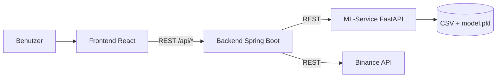
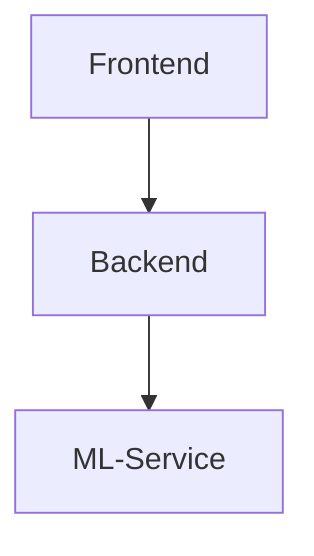
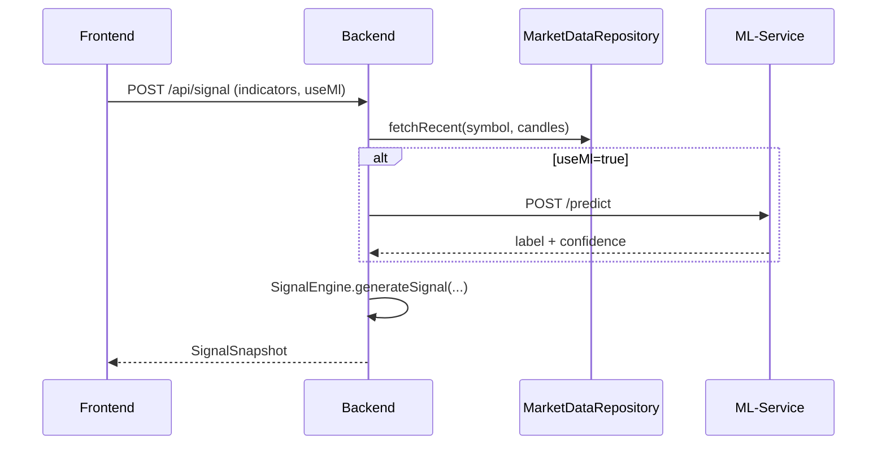
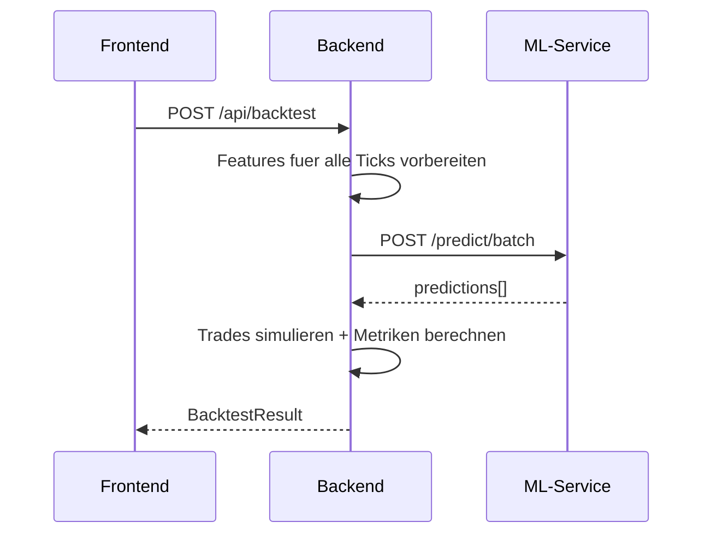
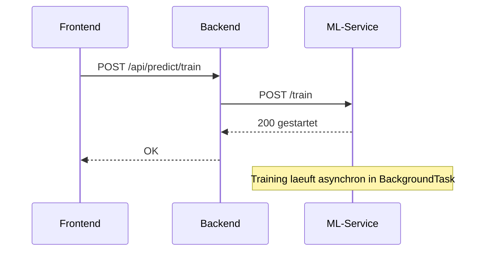
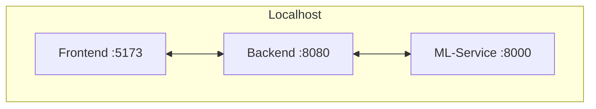

# Architektur-Dokumentation (arc42): KITradingBot

Dieses Dokument beschreibt die Architektur des KITradingBot entlang der arc42-Kapitel 1-12.

---

## 1. Einfuehrung und Ziele

Der KITradingBot ist eine lokale Trading- und Analyseanwendung fuer Kryptowaehrungen (fokussiert auf BTCUSDT), die technische Indikatoren mit ML-Vorhersagen kombiniert.

### Aufgabenstellung
- Marktdaten laden und visualisieren.
- Live-Signale (BUY/SELL/HOLD) aus Indikator-Konsens erzeugen.
- Optional ML in den Signal-Konsens einbeziehen.
- Simulierte Trade-Ausfuehrung (Paper Trading) anbieten.
- Backtests auf historischen Daten durchfuehren.
- ML-Datenupdate und Modelltraining manuell ausloesen.

### Qualitaetsziele (Top 3)
1. Zuverlaessigkeit im lokalen Betrieb (robuste Fehlerantworten, Fallbacks).
2. Wartbarkeit durch klare Schichten und Modulgrenzen.
3. Nachvollziehbarkeit von Signalen/Trades fuer Analyse und Debugging.

---

## 2. Randbedingungen

### Technische Randbedingungen
- Java 21+, Spring Boot 3.3.x (Backend).
- Python 3.10+, FastAPI, scikit-learn (ML-Service).
- React 18 + Vite 5 (Frontend).
- Kommunikation via HTTP/JSON auf `localhost`.

### Betriebliche Randbedingungen
- Zielsystem ist lokaler Entwicklungs-/Lernbetrieb, kein produktiver Echtgeldhandel.
- Keine Datenbank: Trades liegen nur im Speicher.
- Externe Marktdaten primaer ueber Binance REST API, optional aus lokalem CSV-Bestand des ML-Services.

---

## 3. Kontextabgrenzung

### Externe Schnittstellen
- Binance Klines API fuer Candles.
- Lokale HTTP-Schnittstellen:
  - Frontend: `http://localhost:5173`
  - Backend: `http://localhost:8080`
  - ML-Service: `http://localhost:8000`

---

## 4. Loesungsstrategie

- Monorepo mit 3 Services (Frontend, Backend, ML-Service).
- Backend als Orchestrator fuer Marktdaten, Signale, Backtests und Trading-Zustand.
- ML-Service als eigenstaendiger Provider fuer:
  - Einzel-/Batch-Vorhersagen
  - asynchrones Training
  - asynchrones Datenupdate
- Frontend nutzt Hook-basierte Controller-Logik und getrennte View-Komponenten.

---

## 5. Bausteinsicht

### 5.1 Ebene 1: Gesamtsystem

### 5.2 Ebene 2: Backend (Spring Boot)

- `controller/`
  - `MarketController`, `SignalController`, `PredictionController`, `TradeController`, `BacktestController`
- `service/`
  - `MarketDataService`, `SignalService`, `PredictionService`
- `signal/`
  - `HybridSignalEngine` (Indikator- und optionaler ML-Konsens)
- `trading/`
  - `SimulatedTradingEngine` (Paper Trading, In-Memory)
- `backtesting/`
  - `SimpleBacktestEngine` (inkl. Batch-Prediction-Nutzung)
- `integration/`
  - `MlServiceClient` (HTTP-Aufrufe zum ML-Service)
- `repository/`
  - `MockMarketDataRepository` (Binance/ML-Candles), `InMemoryTradeRepository`
- `config/`
  - Properties, CORS, RestTemplate, Exception-Handling

### 5.3 Ebene 2: ML-Service (FastAPI)

- `api.py`: Endpunkte fuer Health, Predict, Predict Batch, Train, Data Update, Data Status.
- `downloader.py`: Datenabruf von Binance.
- `data_processor.py`: Feature-Bildung + Label-Erzeugung.
- `train.py`: Training + Speichern von `model.pkl`.
- `simple_model.py`: Heuristic-Fallback-Klassifikator.

### 5.4 Ebene 2: Frontend (React/Vite)

- `App.jsx`: Einstiegspunkt.
- `hooks/useAppLogic.js`: zentraler UI-Controller.
- `components/*`: reine View-/Panel-Komponenten.
- `api/tradingApi.js`: Backend-API-Client.
- `indicators/tradingViewIndicators.js`: clientseitige Indikator-/Replay-Logik.

---

## 6. Laufzeitsicht

### 6.1 Szenario: Live-Signal abrufen

### 6.2 Szenario: Backtest starten

### 6.3 Szenario: Modelltraining ausloesen

---

## 7. Verteilungssicht

### Deployment-Hinweis
- Start/Stop erfolgt ueber `start-all.ps1` und `stop-all.ps1`.
- Laufzeitlogs liegen unter `.run/`.

---

## 8. Querschnittliche Konzepte

### Fehlerbehandlung
- Backend liefert standardisierte API-Fehler via `GlobalExceptionHandler`.
- ML-Ausfall bei Vorhersage fuehrt im Backend zu Fallback-Label mit 0.50 Konfidenz.

### Konfiguration
- Backend nutzt `trading.*` Properties (Symbol, Limits, Schwellenwerte, URLs).
- CORS ist fuer lokale Frontend-Origins konfiguriert.

### Daten- und Modellfluss
- Trainingsdaten (`training_data.csv`) werden aus Roh-Candles erzeugt.
- Modell wird als `model.pkl` gespeichert und fuer Inferenz geladen.
- Feature-Reihenfolge muss zwischen Python und Java konsistent bleiben.

### Sicherheits-/Betriebskonzept
- Kein Echtgeld-Execution-Adapter enthalten.
- Trades und Kapital nur simuliert.

---

## 9. Architekturentscheidungen

- Detailbeschreibungen und Pflege der Entscheidungen liegen unter `dokumentation/adr/`.
- AD-01: Trennung in 3 Services (Frontend, Backend, ML-Service) statt Monolith.
- AD-02: Backend orchestriert Signallogik zentral; Frontend zeigt und steuert.
- AD-03: Training und Datenupdate im ML-Service asynchron (`BackgroundTasks`).
- AD-04: Trade-Speicherung in-memory fuer einfache lokale Iteration.
- AD-05: Backtest nutzt Batch-Predictions aus Performancegruenden.

---

## 10. Qualitaetsanforderungen

### Qualitaetsbaum (vereinfacht)
- Funktionale Korrektheit
  - konsistente Signalableitung
  - reproduzierbare Backtest-Metriken
- Zuverlaessigkeit
  - API soll bei Teil-Ausfaellen kontrolliert reagieren
- Wartbarkeit
  - klare Modulgrenzen, austauschbare Engines/Services

### Konkrete Szenarien
1. Wenn der ML-Service nicht erreichbar ist, antwortet `POST /api/signal` weiterhin ohne 5xx durch Fallback-Prediction.
2. Ein Backtest mit mehreren hundert Kerzen bleibt interaktiv nutzbar (Batch-API statt N Einzelcalls).
3. Nach `POST /api/trades/reset` ist Trade-Historie leer und Kapital auf Initialwert gesetzt.

---

## 11. Risiken und technische Schulden

- In-Memory-TradeRepository: keine Persistenz ueber Neustarts.
- Keine Authentifizierung/Autorisierung auf API-Ebene.
- Feature-/Indikator-Drift zwischen Frontend-Logik und Backend-Logik moeglich.
- Modell wird pro Inferenzaufruf geladen (I/O-Overhead).
- Keine Transaktionskosten/Slippage im Simulationsmodell.

---

## 12. Glossar

| Begriff | Erklaerung |
| :--- | :--- |
| SignalSnapshot | Aggregierte Antwort fuer Preis, ML-Output, Decision und Feature-Kontext. |
| Batch-Prediction | Mehrere Feature-Vektoren in einem ML-Aufruf (`/predict/batch`). |
| Paper Trading | Simulierter Handel ohne Echtgeld-Ausfuehrung. |
| Warmup-Periode | Mindestzahl historischer Kerzen fuer stabile Indikatorwerte. |
| model.pkl | Serialisiertes ML-Artefakt (Modell + Metadaten). |
